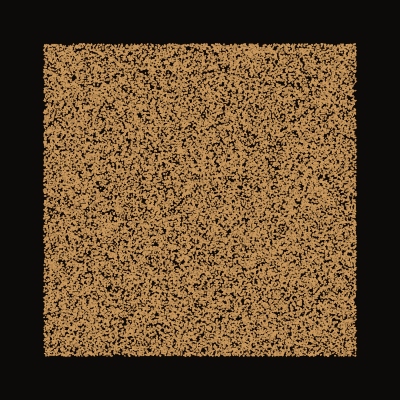

# stv-chladni

<p align="center"></p>

把声音变成"沙粒在振动板上跳动形成的克拉尼纹路"。GPU 实时模拟，支持：

- **实时画面**：打开即监听麦克风，也可边播放音频文件边显示
- **录制实时画面**：把界面里的实时动画录成 mp4，可选同时录入声音
- **导出视频**：在界面里一键导出，或用命令行无头渲染（GPU 渲染 + NVENC 硬件编码，自动混入原音轨）
- **撒沙动画**：重新撒沙时，旧沙先消失，随后新沙从振动板正上方（垂直于板面）落到板面上：
  离镜头近时又大又虚，越落越小、越清晰，最后落定在板面上。时长可调（默认 0.5 秒）
- **方形板 / 圆形板**，多种配色，所有参数可调、可保存为 JSON

## 原理

1. **模态表**：方形自由边板用经典 Chladni 近似
   `φ = cos(mπu)·cos(nπv) ± cos(nπu)·cos(mπv)`，本征值 ∝ m²+n²；
   圆形自由边板用 `J_n(j'_{n,s}·r)·cos(nθ)`（j' 为 J_n' 的零点）。
   本征值按幂律映射到可调的频率区间（默认 90 Hz – 3.2 kHz）。
2. **音频分析**：4096 点 FFT，每个模态在其共振频率附近做对数高斯加权求能量，
   时间平滑后取最强的几个模态作为叠加权重；电平 → 振动强度（自动增益 + 静音门限），
   正向谱通量 → 瞬态冲击（辅音、鼓点会把沙子"震散"）。
   对称模式下只叠加同一对称类的模态，保证图案四重对称。
3. **GPU 模拟**（wgpu 计算着色器）：
   - 每帧在 512×512 网格上叠加模态得到振动场 F；
   - 每个沙粒沿牛顿步 `−F·∇F/|∇F|²` 滑向最近的节线（F=0），
     在波腹处随机弹跳，并带少量抖动决定线宽；声音停止时沙粒静止，图案保留。
4. **渲染**：每个沙粒一个实例化圆点，读回像素后通过管道交给 ffmpeg 编码。

## 下载

转到 [Releases](https://github.com/334456777/stv-chladni/releases)：解压后双击 `stv.exe`，
也可以把音频 / 视频文件拖到 `stv.exe` 上直接打开。
发布包自带 ffmpeg（`ffmpeg\` 文件夹），也已静态链接 VC++ 运行库，不用另装。

`stv.exe` 是窗口程序，双击不会弹出终端；旁边的 `stv.com` 是同一程序的控制台版，供命令行使用：
在终端里输入 `stv …` 时 Windows 先找到 `stv.com`，终端会等它结束并显示输出。

## 依赖

- Rust（stable）
- [ffmpeg](https://ffmpeg.org/download.html)：用于解码任意音频/视频和编码输出。依次查找环境变量 `STV_FFMPEG`、
  stv.exe 旁边的 `ffmpeg\ffmpeg.exe` 或 `ffmpeg.exe`、PATH 中的 `ffmpeg`。
  只用麦克风实时画面时不需要；找不到 ffmpeg 时界面顶部会提示。
- 支持 DX12 / Vulkan / Metal 的显卡。界面在 Windows 上优先使用 DX12（部分驱动的 Vulkan 交换链不遵守垂直同步，会导致拖动窗口滞后）；
  某块显卡的 DX12 无法创建设备时，自动改用它的 Vulkan 或另一块显卡，都不行时启动失败的弹窗里列出各显卡的错误和错误日志。
  有 NVIDIA 显卡时自动使用 `h264_nvenc`，否则回退到 `libx264`。

## 构建

```bash
cargo build --release
```

Windows 上构建时会给 exe 嵌入图标和版本信息，需要 Windows SDK 的 `rc.exe`
（装 Visual Studio 生成工具时一般已带）。图标由 `scripts/make_icon.py` 生成。
编译出的 stv.exe 是窗口程序，开发时用 `cargo run --release -- render …` 跑命令行（cargo 会等它结束）。

打 Windows 发布包（编译 release，生成控制台版 `stv.com`，并把 PATH 中的 ffmpeg 连同 DLL 和许可放进 `ffmpeg\`）：

```bash
pwsh -File scripts/package.ps1
```

输出在 `target\dist`；用 `-Ffmpeg <ffmpeg.exe 路径>` 指定别的 ffmpeg 构建。

可执行文件位于 `target/release/stv(.exe)`。

## 使用

### 图形界面

```bash
stv                  # 打开界面并开始监听默认麦克风
stv song.mp3         # 打开界面并立即播放文件（同 stv gui song.mp3）
stv gui --config my.json --volume 0.5
stv gui --sprinkle 1.2   # 撒沙动画时长 1.2 秒（0.1～5）
```

`--volume`、`--sprinkle` 只对本次启动生效；在界面里改动对应滑条后，会按新值保存。

左侧面板从上到下：

- "音源"：麦克风实时监听（默认）、"重新撒沙"、"打开音频 / 视频…"（也可直接把文件拖进窗口；空格键播放 / 暂停）
- "录制实时画面"：点"开始录制"，把实时动画录成 mp4；勾选"同时录入声音"会录下麦克风或正在播放的文件
  （录的是原始声音，播放音量调到 0 也能录到）。分辨率、帧率、编码与"导出视频"相同，
  默认保存到 `用户目录\Videos\stv`，文件名带录制时间。录制中不能切换音源；关闭窗口时会先保存好录像
- "导出视频"：导出最近打开的音频 / 视频文件；选择分辨率（方形 / 横屏 / 竖屏 / 4K）、帧率、编码器后开始导出，
  后台进行，可取消
- "外观""沙粒""振动板与模态"：实时调参，效果立即可见；"沙粒"里的"撒沙时长"控制撒沙动画快慢
- "参数文件"：保存 / 载入 JSON（与命令行 `--config` 通用）

底部是实时频谱、当前激活的模态及其权重。

界面参数会在退出时自动保存，下次启动恢复。

### 无头渲染

```bash
stv render voice.wav                              # 输出 voice_stv.mp4，1080×1080@30
stv render talk.m4a -o out.mp4 --width 1920 --height 1080 --fps 60
stv render song.mp3 --preset gold                 # 金沙·圆形板
stv render in.mp4 --start 10 --duration 15 --codec x264 --quality 20
stv config -o my.json                             # 导出默认参数，修改后：
stv render in.wav --config my.json
```

| 参数 | 说明 |
| --- | --- |
| `--width/--height/--fps` | 输出尺寸与帧率 |
| `--codec auto\|nvenc\|x264` | 编码器，默认自动 |
| `--quality` | CRF/CQ，越小越清晰（默认 18） |
| `--start/--duration` | 截取音频片段 |
| `--preset sand\|gold\|ice\|mint` | 风格预设 |
| `--shape square\|circle` | 振动板形状 |
| `--particles` | 沙粒数量 |
| `--config` | 参数 JSON |

### 其他

```bash
stv devices          # 列出音频输入设备
```

麦克风没有反应时：界面会提示"没有收到音频数据"（多半是系统隐私设置拦截）或
"收到的全是静音数据"（多半是麦克风被硬件静音）。

### 测试

```bash
cargo test --release
```

## 主要参数

| 参数 | 作用 |
| --- | --- |
| `max_order` | 最高模态阶数，越高图案越密 |
| `freq_lo / freq_hi` | 模态映射的频率范围 |
| `sharpness / top_modes` | 主导模态有多"独占"、同时叠加几个模态 |
| `smoothing / attack / release` | 图案停留时间与过渡快慢 |
| `pull / jitter / bounce` | 聚拢力度、线条粗细、波腹弹跳 |
| `onset_kick` | 瞬态散射强度 |
| `sprinkle_secs` | 撒沙动画时长（秒），命令行 `stv gui --sprinkle` |
| `particles / grain_size` | 沙粒数量与颗粒大小 |

## 代码结构

```
src/
  main.rs          命令行入口
  params.rs        参数与预设
  modes.rs         板模态表、贝塞尔函数与零点
  analysis.rs      FFT 分析 → 模态权重 / 振动强度 / 瞬态
  gpu/             wgpu 模拟器与 WGSL 着色器（field / particles / render）
  audio/           ffmpeg 解码、cpal 麦克风输入与文件播放
  export.rs        无头导出（GPU → ffmpeg 管道）
  record.rs        实时录制（读回画面 → ffmpeg，可选混入声音）
  gui.rs           egui 界面
build.rs               Windows 上嵌入图标和版本信息
assets/                图标、README 演示动图
vendor/gpu-allocator/  windows 依赖固定为 0.58 的 gpu-allocator（原因见 Cargo.toml 的注释）
scripts/package.ps1    打 Windows 发布包
scripts/make_icon.py   生成图标（克拉尼沙纹）
.claude/skills/        本项目的 Claude Code skill（stv-trim-prose：清理注释和文档里多余的句子）
```

## 许可

stv 以 [MIT](LICENSE) 许可发布。发布包里的 `ffmpeg\` 是独立的 FFmpeg 程序，stv 只是启动它，
它按自己的许可（目前随附的构建为 GPLv3）分发，许可文本和源码地址见该文件夹里的 LICENSE 与 README.txt。
